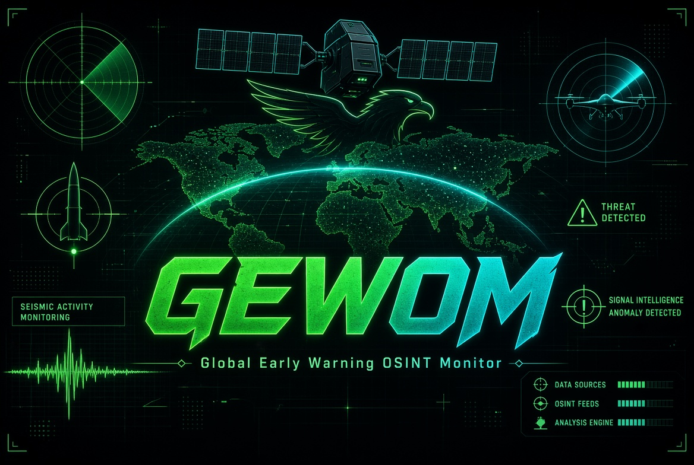

# 🛰️ GEWOM — Global Early Warning OSINT Monitor
<p align="center">
  
</p>




[](https://github.com/Condor2026/GEWOM/issues?q=label%3Abug)
[](https://github.com/Condor2026/GEWOM/issues?q=label%3Aenhancement)
[](https://github.com/Condor2026/GEWOM/issues?q=label%3Adocumentation)
[](https://github.com/Condor2026/GEWOM/issues?q=label%3Asecurity)
[](https://github.com/Condor2026/GEWOM/issues?q=label%3Aaccessibility)
[](https://github.com/Condor2026/GEWOM/issues?q=label%3Asource)
[](https://github.com/Condor2026/GEWOM/issues?q=label%3Atelegram)
[](https://github.com/Condor2026/GEWOM/issues?q=label%3Atranslation)
[](https://github.com/Condor2026/GEWOM/issues?q=label%3Adetection)
[](https://github.com/Condor2026/GEWOM.py/issues?q=label%3Aperformance)
[](https://github.com/Condor2026/GEWOM.py/issues?q=label%3Aquestion)
[](https://github.com/Condor2026/GEWOM/issues?q=label%3A%22help+wanted%22)
[](https://github.com/Condor2026/GEWOM/issues?q=label%3A%22good+first+issue%22)


Monitor **OSINT** de alerta temprana global: agrega alertas de misiles, drones, ataques, sismos/explosiones, comunicados oficiales y prensa de guerra desde **más de 20 fuentes públicas** (sin necesidad de claves API para funcionar).

Servidor local en `http://127.0.0.1:5000` con dashboard web y API JSON.

> ⚠️ **Lee el [DISCLAIMER](DISCLAIMER.md) antes de usar.** Esta herramienta agrega fuentes públicas; **no es un sistema oficial de alerta temprana**.

---

## ✨ Características

- 🚨 **Alertas en tiempo real** de Israel (Tzeva Adom, Oref) y Ucrania (alerts.com.ua, Ubilling, Kyiv Digital, Neptun).
- 🌍 **Sensores sísmicos** (USGS + EMSC + GEOFON) con heurística de candidatos a explosión.
- 🔥 **NASA FIRMS**, **NASA EONET**, **GDELT GEO**.
- 📰 **Prensa de guerra y OSINT verificable** (ISW, Bellingcat, Oryx, Kyiv Independent, Meduza…).
- 🏛️ **Comunicados oficiales** (Dept. Estado USA, FCDO UK, OTAN, Kremlin, IAEA, ONU…).
- 📡 **Telegram** (canales públicos) + buscador nativo opcional con Telethon.
- 🧠 **Credibilidad A/B/C/D** (oficial / prensa-OSINT / parte implicada / no verificado).
- 💾 **Historial en SQLite** con deduplicación y exportación CSV/JSON.
- 🌐 **Traducción** automática opcional (Google gtx + MyMemory, DeepL / LibreTranslate).
- ⚡ **Cache TTL 15s** y ejecución paralela de fuentes.

---

## 📚 Fuentes integradas

| Categoría | Fuentes |
|-----------|---------|
| **Israel** | Tzeva Adom, Oref (oficial) |
| **Ucrania** | alerts.com.ua, Ubilling, alerts.in.ua, Kyiv Digital, Neptun |
| **Satélite / global** | NASA FIRMS, NASA EONET, GDELT GEO, GDELT Cloud, World Monitor |
| **Sísmico** | USGS, EMSC, GEOFON |
| **Prensa / OSINT** | ISW, Bellingcat, Oryx, Kyiv Independent, Meduza, Moscow Times, Critical Threats, TWZ, Defense One, ONU Noticias |
| **Comunicados oficiales** | Dept. Estado USA, FCDO UK, MoD UK, Kremlin, OTAN, IAEA, ONU, CENTCOM, Pentágono, Casa Blanca, UE |
| **Medios estatales** (cred. C) | TASS, RT, Sputnik, IRNA, Tasnim, Press TV, Xinhua, CGTN, WAFA, SANA, Anadolu, Ukrinform |
| **Telegram** | Rybar, Readovka, WarGonzo, DeepState, UA Air Force, Estado Mayor UA, IDF, SBU, MID Rusia, Military Summary, Intel Slava |

> ⚠️ **Ninguna fuente garantiza veracidad en zona de guerra.** Los niveles de credibilidad indican el tipo de fuente, no la certeza del hecho.

---

## 🚀 Instalación rápida

```bash
git clone https://github.com/Condor2026/GEWOM
cd GEWOM
chmod +x install.sh
./install.sh
nano .env      # opcional: claves API
./run.sh
```

Abre 👉 http://127.0.0.1:5000

## 🐧 Linux / macOS
```bash
cd ~/GEWOM         # o donde tengas la carpeta
python3 -m venv venv
source venv/bin/activate
pip install -r requirements.txt
python GEWOM.py
```

## Si no tienes requirements.txt:
```bash
pip install flask requests beautifulsoup4 urllib3
```

### Instalación manual

```bash
python3 -m venv venv
source venv/bin/activate          # Windows: venv\Scripts\activate
pip install -r requirements.txt
python GEWOM.py
```

### Dependencia opcional

```bash
pip install telethon               # Búsqueda nativa de Telegram
```

---

## ⚙️ Configuración

Copiá `.env.example` a `.env` y editá lo que necesites. Todas las variables son opcionales.

| Variable | Uso |
|----------|-----|
| `MONITOR_HOST` / `MONITOR_PORT` | Servidor local (defecto `127.0.0.1:5000`) |
| `NASA_FIRMS_KEY` | NASA FIRMS (opcional) |
| `GDELT_API_KEY` | GDELT Cloud (opcional) |
| `WORLD_MONITOR_KEY` | World Monitor (opcional) |
| `ALERTS_UA_TOKEN` | alerts.in.ua (opcional) |
| `TG_API_ID` / `TG_API_HASH` | Telethon (opcional) |
| `DEEPL_API_KEY` / `LIBRETRANSLATE_*` | Traducción opcional |
| `EXTRA_RSS_FEEDS` / `EXTRA_WAR_FEEDS` / `EXTRA_STATEMENT_FEEDS` / `EXTRA_STATE_FEEDS` | Feeds extra |

---

## 🖥️ Uso

```bash
# Arrancar el servidor
python GEWOM.py

# Host/puerto personalizados
MONITOR_HOST=0.0.0.0 MONITOR_PORT=8080 python GEWOM.py

# Login único de Telethon
python GEWOM.py --tg-login
```

---

## 🔌 Endpoints API

| Método | Ruta | Descripción |
|--------|------|-------------|
| `GET` | `/api/alerts?force=1` | Alertas agregadas + stats |
| `GET` | `/api/health` | Estado del servidor |
| `GET` | `/api/sources` | Estado de cada fuente |
| `GET` | `/api/history?hours=24` | Historial desde SQLite |
| `GET` | `/api/export?format=csv` | Exportar historial |
| `GET/POST` | `/api/telegram/channels` | Listar / añadir canal |
| `DELETE` | `/api/telegram/channels/<id>` | Desactivar canal |
| `GET` | `/api/telegram/search?q=` | Buscar canales |
| `GET` | `/api/telegram/preview` | Vista previa |

---

## 🏗️ Estructura del proyecto

```
GEWOM.py/  ← (nombre del repo)
│
├── .github/
│   ├── ISSUE_TEMPLATE/
│   │   ├── accessibility.md
│   │   ├── bug_report.md
│   │   ├── config.yml
│   │   └── feature_request.md
│   └── PULL_REQUEST_TEMPLATE.md
│
├── .env.example
├── .gitignore
├── CHANGELOG.md
├── CODE_OF_CONDUCT.md
├── CONTRIBUTING.md
├── DISCLAIMER.md
├── GEWOM.py
├── LICENSE
├── README.md
├── SECURITY.md
├── install.sh
├── requirements.txt
└── run.sh
```

---

## 🤝 Contribuir

Ver [CONTRIBUTING.md](CONTRIBUTING.md) y [CODE_OF_CONDUCT.md](CODE_OF_CONDUCT.md).

- **Issues:** [abrir uno](https://github.com/Condor2026/GEWOM.py/issues/new/choose)
- **PRs:** [ver abiertos](https://github.com/Condor2026/GEWOM.py/pulls)
- **Discusiones:** [Discussions](https://github.com/Condor2026/GEWOM.py/discussions)

---

## ♿ Accesibilidad

Si encuentras un problema de accesibilidad, abre un issue con la plantilla
[accesibilidad](.github/ISSUE_TEMPLATE/accessibility.md) y la etiqueta `accessibility`.
El panel se está alineando con **WCAG 2.1 nivel AA** en la medida de lo posible.

---

## 🔒 Seguridad

Ver [SECURITY.md](SECURITY.md). **No abras issues públicos para vulnerabilidades** — usa [GitHub Security Advisories](https://github.com/Condor2026/GEWOM.py/security/advisories/new).

---

## 📋 Changelog

Ver [CHANGELOG.md](CHANGELOG.md).

---

## ⚠️ Disclaimer

Proyecto OSINT puro con fines de investigación. Las alertas pueden ser falsos positivos. **No sustituye** fuentes oficiales. Ver [DISCLAIMER.md](DISCLAIMER.md).

---

## 📄 Licencia

MIT — ver [LICENSE](LICENSE).

---

## 🙏 Créditos

Fuentes públicas: Tzeva Adom, Oref, alerts.com.ua, Ubilling, Kyiv Digital, NASA, USGS, EMSC, GEOFON, GDELT, ONU, OTAN, IAEA, y medios citados en código.
